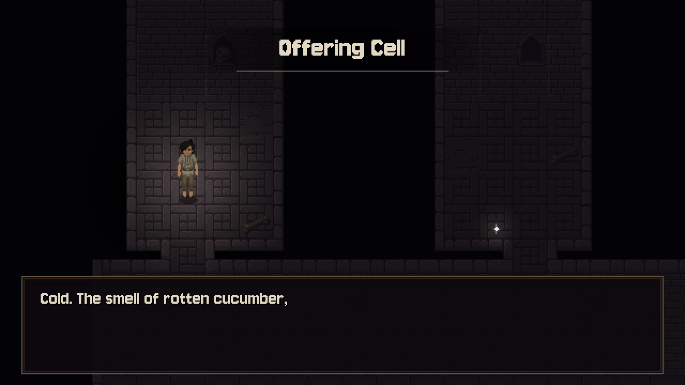
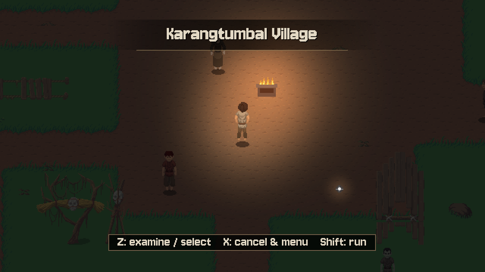
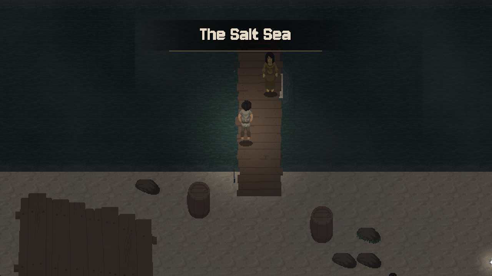
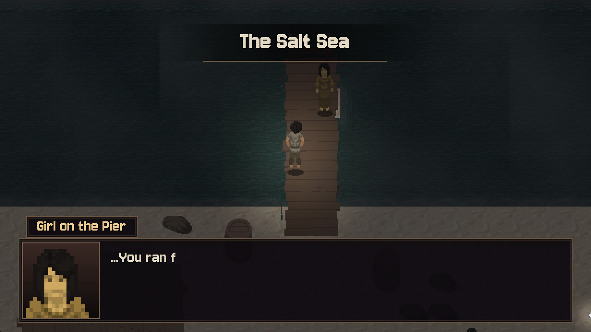
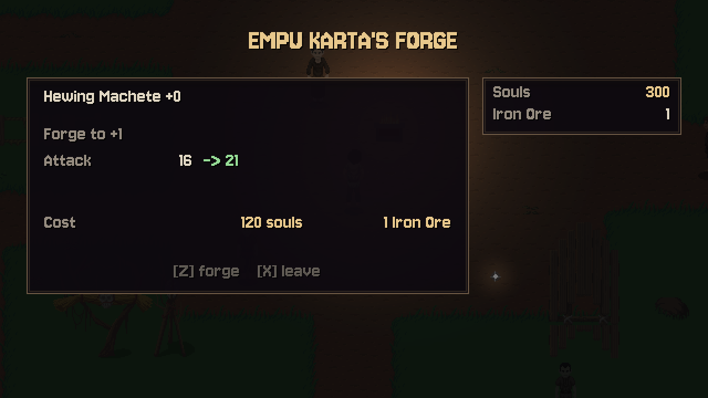
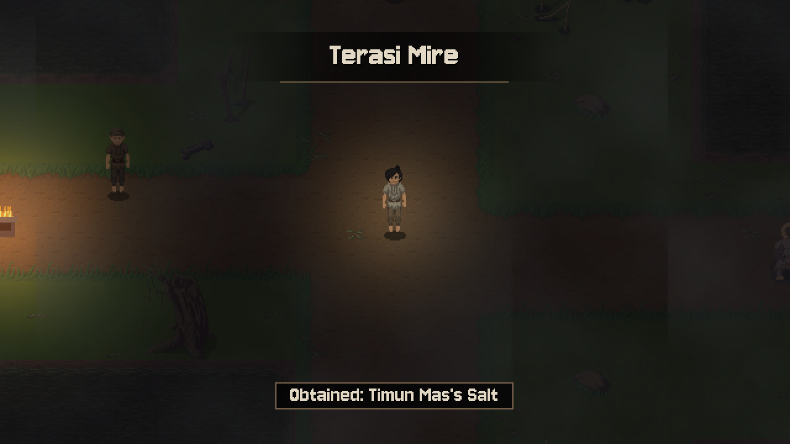
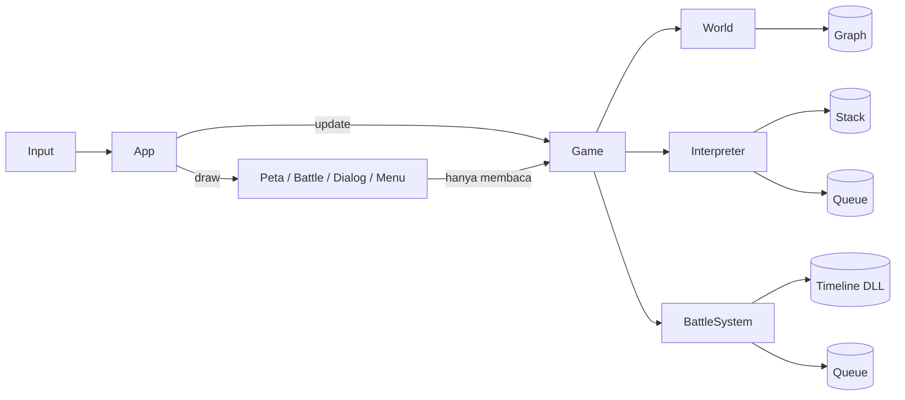

<h1 align="center">TUMBAL</h1>

<p align="center">
  <i>JRPG cerita rakyat Jawa versi kelam dengan mekanik ala Souls, dibuat dari nol dengan C++17 dan raylib.</i>
</p>

<p align="center">
  <a href="#-mulai-cepat">Mulai Cepat</a> •
  <a href="#-fitur">Fitur</a> •
  <a href="#-screenshot">Screenshot</a> •
  <a href="#-struktur-data">Struktur Data</a> •
  <a href="#-dokumentasi">Dokumentasi</a>
</p>

<p align="center">
  
  
  
  
  
  
  
</p>

<p align="center">
  
</p>

<p align="center">
  <b>⚔️ Battle ATB mode wait</b> <i>(gauge AP, rapal, tunda giliran, strip prediksi urutan giliran)</i>
  <br>
  <b>🔥 Loop Souls</b> <i>(Tungku, sukma tercecer yang bisa diambil sekali, musuh yang bangkit lagi)</i>
  <br>
  <b>🗺️ Dunia yang saling terhubung</b> <i>(8 peta, jalan pintas terkunci, jalan satu arah, warp antar-Tungku)</i>
  <br>
  <b>📜 Cerita utuh</b> <i>(Timun Mas dan Buto Ijo versi kelam, dari sel pertama sampai tamat)</i>
  <br>
  <b>🧱 Struktur data buatan sendiri</b> <i>(doubly linked list, graph, stack, queue: tanpa container STL di core)</i>
</p>

<details>
<summary><b>Daftar Isi</b></summary>

- [Mulai Cepat](#-mulai-cepat)
- [Screenshot](#-screenshot)
- [Tentang Game](#-tentang-game)
- [Fitur](#-fitur)
- [Struktur Data](#-struktur-data)
- [Arsitektur](#-arsitektur)
- [Struktur Proyek](#-struktur-proyek)
- [Opsi Baris Perintah](#-opsi-baris-perintah)
- [Alat Aset & Peta](#-alat-aset--peta)
- [FAQ](#-faq)
- [Dokumentasi](#-dokumentasi)
- [Tim](#-tim)
- [Kredit & Lisensi](#-kredit--lisensi)

</details>

---

## 🚀 Mulai Cepat

> [!TIP]
> Game dimulai dalam **English**. Bahasa bisa diganti ke **Bahasa Indonesia** kapan saja lewat **Settings** (layar judul atau menu X di dalam game); pilihan ini tersimpan.

### Kebutuhan

- Windows dengan [MSYS2](https://www.msys2.org/) dan toolchain **UCRT64**
- `C:\msys64\ucrt64\bin` ada di `PATH`

```bash
pacman -S mingw-w64-ucrt-x86_64-gcc mingw-w64-ucrt-x86_64-raylib mingw-w64-ucrt-x86_64-make
```

### Build & main

```bash
mingw32-make run           # build lalu jalankan game
mingw32-make test          # build lalu jalankan semua unit test
bin/tumbal.exe --console   # logika game yang sama, dimainkan sebagai teks di terminal
```

### Kontrol

| Tombol | Fungsi |
|--------|--------|
| Panah / WASD | Jalan (8 arah) |
| Shift | Lari |
| Z / Enter | Konfirmasi, periksa, bicara, istirahat di Tungku |
| X / Esc | Batal, buka menu (Barang, Status, Simpan, Cheat, Pengaturan, Keluar) |
| Tahan Z saat battle | Mempercepat animasi |
| F1 | Inspector struktur data |
| F3 | Tampilkan collision |
| F9 | Menu cheat |

> [!NOTE]
> Seperti Black Souls, game **tidak pernah menyimpan saat kamu mati**. Simpan di mana saja lewat menu (3 slot), lalu muat ulang dari layar judul untuk membatalkan kematian.

---

## 📸 Screenshot

<table>
<tr>
<td width="50%">

**Layar judul**


</td>
<td width="50%">

**Sel pertama**: cerita dibuka di lumbung tempat anak-anak disimpan



</td>
</tr>
<tr>
<td width="50%">

**Desa Karangtumbal**: hub dengan Tungku, pandai besi, dan pedagang



</td>
<td width="50%">

**Laut Garam**: Timun Mas menunggu di ujung dermaga yang membusuk



</td>
</tr>
<tr>
<td width="50%">

**Battle**: ATB mode wait dengan strip prediksi urutan giliran


</td>
<td width="50%">

**Dialog**: potret pembicara diambil dari sprite peta tiap karakter



</td>
</tr>
<tr>
<td width="50%">

**Pedagang keliling**: stok terbatas, dibayar dengan sukma


</td>
<td width="50%">

**Tungku tempa Empu Karta**: tempa senjata dari +0 sampai +3



</td>
</tr>
<tr>
<td width="50%">

**Rawa Terasi**: kabut, gelagah, dan Tungku terakhir sebelum sarang



</td>
<td width="50%">

**Sarang Buto**: lereng bertiang tengkorak menuju boss terakhir


</td>
</tr>
</table>

Screenshot diambil dari versi English (bahasa bawaan). Pratinjau penuh setiap wilayah ada di
[`docs/map_preview/`](docs/map_preview/).

---

## 🎯 Tentang Game

Dalam dongeng, Timun Mas lolos dari raksasa Buto Ijo dengan melempar empat bekal ajaib ke belakangnya: biji timun
yang menjadi ladang, jarum yang menjadi hutan bambu, garam yang menjadi laut, dan terasi yang menjadi rawa.
**TUMBAL** bertanya apa yang terjadi sesudahnya: sihir itu tidak pernah hilang, melainkan membusuk, dan desa
Karangtumbal terus memberi makan sang raksasa dengan anak-anaknya sejak saat itu.

Kamu adalah seorang **tumbal** yang seharusnya sudah dimakan, tetapi justru terbangun.

Game ini dibuat untuk **Tugas Besar Struktur Data**. Mekaniknya diadaptasi dari *Black Souls 1* (game RPG Maker
VX Ace): yang ditiru hanya **sistemnya**. Dunia, cerita, tokoh, peta, teks, dan art semuanya orisinal.

### Dibuat untuk

- 🎓 **Tugas Struktur Data**: setiap struktur data yang dinilai ditulis manual dengan node dan pointer, dan benar-benar dipakai mekanik yang berjalan
- 🕹️ **Sesi bermain sungguhan**: sekitar 45–60 menit dari sel pertama sampai tamat
- 🖥️ **GUI dan console**: logika game tidak bergantung pada renderer, dibuktikan dengan mode teks yang lengkap

---

## ✨ Fitur

### ⚔️ Battle (M1)

- **ATB mode wait** seperti Black Souls: gauge AP terisi sesuai Gesit dan berhenti total saat kamu memilih perintah
- **Strip urutan giliran** yang diprediksi dengan menyimulasikan salinan antrean giliran
- **Rapal & tunda**: jurus kuat butuh waktu merapal; jurus tunda mendorong giliran musuh mundur dan membuyarkan rapalnya
- **Elak & Tangkis** untuk semua kelas, efek status (racun, berdarah, terbakar, tidur, takut, cepat, lambat, ...), elemen
- **Serangan boss yang ditelegrafkan**: jurus besar Buto Ijo dirapal dulu; namanya muncul di atas musuh dan anggota party yang diincar berkedip
- **Boss multi-bagian**: kepala dan dua tangan Buto Ijo; tumbangkan kepalanya dan kedua tangan ikut runtuh

### 🗺️ Dunia & loop Souls (M2)

- **8 peta yang saling terhubung**: Sel Tumbal → Lorong Lumbung → Desa Karangtumbal → Ladang Timun Busuk → Hutan Bambu Jarum → Laut Garam → Rawa Terasi → Sarang Buto
- **Musuh terlihat di peta** yang mengejarmu; menyentuh mereka dari belakang memberimu serangan pertama
- **Tungku**: istirahat untuk pulih dan mengisi ulang Ramuan Jamu, naik level dengan sukma, warp ke Tungku menyala yang terjangkau
- **Sukma tercecer**: mati, dan sukmamu tertinggal di tempat kamu jatuh; ambil kembali sekali, atau hilang selamanya
- **Jalan pintas & gerbang**: jalan yang terkunci sampai boss kalah, jalan pintas bambu kembali ke desa, jalan satu arah turun ke sarang

### 📜 Cerita & event (M3)

- **Interpreter event** untuk dialog, pilihan, kondisi bersarang, barang, battle, pindah peta, dan toko
- **NPC yang bereaksi**: Mbok Srini menanggapi apa yang sudah kamu lakukan; pendamping **Timun Mas** bergabung ke party
- **Tungku tempa Empu Karta** (senjata +0 sampai +3 dengan sukma dan Bijih Besi) dan **pedagang keliling**
- **Dua bahasa**: English (bawaan) dan Bahasa Indonesia, bisa diganti di Pengaturan

### 🎨 Tampilan & suara

- Peta pixel art dengan palet per wilayah, hiasan tersebar, kabut bergerak, dan cahaya obor
- Battler front-view, musik desa bergaya gamelan buatan sendiri, musik per peta dengan crossfade, efek suara
- Layar judul, pembuatan karakter (nama, kelas, hadiah awal), 3 slot simpan, layar tamat

### 🛠️ Perkakas

- **377 unit test** untuk struktur data, battle, dunia, event, simpan/muat, dan terjemahan
- Mode teks `--console`, screenshot otomatis `--shots`, simulator battle `--balance`
- Generator Python untuk aset, peta, pratinjau peta, musik, dan terjemahan
- **Menu cheat** bawaan (F9) untuk uji coba atau cepat tamat; layar tamat mencatat bila cheat dipakai

---

## 🧱 Struktur Data

Semua struktur data yang dinilai ada di [`src/core/adt/`](src/core/adt/), ditulis manual dengan node dan pointer.
Core game (`src/core/`) **tidak memakai container STL** (`std::vector`, `std::list`, `std::map`, ...) dan tidak
pernah meng-include raylib.

| Mekanik | Struktur utama | Jenis | Perannya di game |
|---------|----------------|-------|------------------|
| **M1** Battle ATB + antrean giliran | `Timeline<Battler>`: **doubly linked list** terurut | Linear | Head = yang bertindak berikutnya. Rapal dan tunda memindahkan node ke posisi barunya; strip giliran berasal dari salinan list |
| **M2** Dunia & Tungku | `Graph<MapInfo>`: **adjacency multi linked list** | Non-linear | Peta = vertex, jalan = edge yang bisa terkunci atau satu arah. BFS mencari Tungku yang terjangkau; traversal penuh menghidupkan musuh lagi |
| **M3** Interpreter event | `Stack<Frame>` + `Queue<std::string>` | Linear | Cabang dan skrip yang dipanggil mem-push frame lalu kembali secara LIFO; notifikasi tampil satu per satu |
| Pendukung | `Queue<BattleEvent>` | Linear | Logika battle mengantrekan kejadian; GUI dan console memutarnya berurutan |

| Berkas | ADT | Operasi |
|--------|-----|---------|
| [`Timeline.hpp`](src/core/adt/Timeline.hpp) | Doubly linked list terurut | `insertSorted`, `remove`, `popFront`, `search`, `updateAV` (relink), `subtractAll`, traversal maju/mundur |
| [`Graph.hpp`](src/core/adt/Graph.hpp) | Graph berarah berbobot, edge bisa dikunci | `addVertex`, `addEdge`, `addArc`, `setOpen`, `isOpen`, `removeEdge`, `bfs`, `dijkstra`, `isConnected` |
| [`Stack.hpp`](src/core/adt/Stack.hpp) | Stack berbasis linked list | `push`, `pop`, `peek`, traversal |
| [`Queue.hpp`](src/core/adt/Queue.hpp) | Queue berbasis linked list | `enqueue`, `dequeue`, `peek`, traversal |

Setiap operasi struktur data yang dipakai mekanik dicatat (`dsOp`) dan tampil langsung di **Inspector F1** serta
sebagai baris `[DS]` di mode console. Penjelasan lengkap (kompleksitas, subprogram, catatan presentasi) ada di
[`docs/STRUKTUR_DATA.md`](docs/STRUKTUR_DATA.md).

---

## 🏗️ Arsitektur

```
┌──────────────────────────────────────────────────────────────────────────┐
│                     GUI  (src/gui, raylib)                               │
│  Judul · Peta · Battle · Dialog · Menu · Tungku · Toko · Inspector       │
│  membaca state core, meneruskan input — tidak ada aturan game di sini    │
└──────────────┬───────────────────────────────────────────┬───────────────┘
               │                                           │
               ▼                                           ▼
┌──────────────────────────────────────────────────────────────────────────┐
│                     CORE GAME  (src/core, tanpa raylib & container STL)  │
│                                                                          │
│  game/   Game (perangkai), GameState (party, sukma, barang, flag, simpan)│
│  battle/ BattleSystem ── Timeline DLL (M1) · Queue<BattleEvent>          │
│  world/  World ── Graph peta (M2) · Field (gerak, musuh)                 │
│  event/  Interpreter ── Stack<Frame> · Queue<notifikasi> (M3) · Skrip    │
│  data/   GameData (jurus, barang, musuh, kelas, senjata, dagangan)       │
│  util/   parser Json · Lang (kamus EN/ID) · Rng · DsTrace                │
└──────────────┬───────────────────────────────────────────┬───────────────┘
               │                                           │
               ▼                                           ▼
     CONSOLE  (src/console)                       BERKAS DATA  (assets/)
     mode teks · simulator --balance              peta Tiled · skrip event JSON
                                                  lang/en.json · art · audio
```



---

## 📁 Struktur Proyek

```
.
├── src/
│   ├── core/            logika game (tanpa raylib): adt/, battle/, data/, event/, game/, util/, world/
│   ├── gui/             tampilan raylib: layar-layar, audio, helper UI, pengaturan
│   ├── console/         mode teks dan simulator --balance
│   └── main.cpp         titik masuk dan opsi baris perintah
├── tests/               unit test (ADT, battle, dunia, event, terjemahan)
├── assets/
│   ├── maps/            peta Tiled (.tmj) + world.json, dibuat tools/make_maps.py
│   ├── events/          skrip cerita & NPC (JSON)
│   ├── lang/            en.json, dibuat tools/lang_en.py
│   ├── src/ raw/        art sumber & gambar asli Codex untuk tools/build_assets.py
│   └── tiles/ props/ chars/ battlers/ battlebacks/ faces/ audio/ fonts/
├── tools/               generator dan pemeriksa berbasis Python
├── docs/                rencana, panduan demo, struktur data, screenshot, pratinjau peta
├── CREDITS.md           setiap aset pihak ketiga dan buatan AI, beserta lisensinya
└── Makefile
```

---

## ⌨️ Opsi Baris Perintah

| Opsi | Keterangan |
|------|------------|
| *(tanpa opsi)* | Jalankan game |
| `--console` | Main di terminal dengan logika core yang sama (perintah: `w/a/s/d`, `x`, `graph`, `tungku`, `simpan`, `muat`, `cheat`, ...) |
| `--shots` | Ambil screenshot otomatis semua peta, dialog, battle, menu, dan boss (`shot_*.png`) |
| `--balance` | Simulasikan ribuan battle per kelas × kelompok musuh × level lalu cetak kurva kesulitannya |
| `--smoke` | Buka jendela sebentar lalu keluar (cek build) |

---

## 🧰 Alat Aset & Peta

Semua alat dijalankan dengan Python MSYS2 (`/c/msys64/ucrt64/bin/python.exe`) dari root repositori.

| Skrip | Fungsi |
|-------|--------|
| `tools/build_assets.py` | Membangun karakter, tile, props, battler, potret, dan art Codex dari `assets/src` dan `assets/raw` |
| `tools/make_maps.py` | Membuat semua peta dari tata letak ASCII menjadi berkas Tiled `.tmj` + `world.json` |
| `tools/render_maps.py` | Menggambar pratinjau penuh setiap peta ke `docs/map_preview/` |
| `tools/make_gamelan.py` | Menyintesis musik desa bergaya gamelan (`assets/audio/music/desa.ogg`) |
| `tools/lang_en.py` | Menulis kamus Inggris `assets/lang/en.json` |
| `tools/lang_keys.py` | Mengumpulkan semua teks yang tampil ke pemain dan melaporkan yang belum diterjemahkan |

---

## ❓ FAQ

<details>
<summary><b>Apakah ini tiruan Black Souls?</b></summary>

Bukan. Yang diadaptasi hanya **sistem** game-nya (ATB mode wait, sukma sebagai mata uang dan EXP, checkpoint ala
api unggun, sukma tercecer, simpan di mana saja). Dunia, cerita, tokoh, peta, dialog, dan art adalah karya orisinal
atau berasal dari paket berlisensi terbuka yang tercantum di `CREDITS.md`.

</details>

<details>
<summary><b>Kenapa tidak memakai <code>std::vector</code> atau <code>std::map</code>?</b></summary>

Ketentuan tugas mewajibkan struktur data yang dinilai dibuat manual. Aturan ini diterapkan ke seluruh core game
(`src/core/`), jadi setiap list, queue, stack, dan graph di sana dibangun dari node dan pointer atau array mentah.
GUI boleh memakai standard library.

</details>

<details>
<summary><b>Game-nya terlalu susah. Bisa lewati grinding?</b></summary>

Bisa. Tekan **F9** (atau buka menu → **Cheat**) untuk sukma dan level gratis, tambahan stat, senjata +3, kebal,
sekali pukul tumbang, atau membuka semua jalan. Layar tamat mencatat bila cheat dipakai.

</details>

<details>
<summary><b>Apakah bisa jalan di Linux atau macOS?</b></summary>

Kodenya C++17 dan raylib yang portabel, tetapi Makefile dan petunjuknya ditujukan untuk Windows dengan MSYS2 UCRT64.
Platform lain belum diuji.

</details>

---

## 📚 Dokumentasi

| Dokumen | Isi |
|---------|-----|
| [Panduan demo](docs/DEMO.md) | Rute lengkap, tempat tiap struktur data terlihat, cek cepat |
| [Struktur data](docs/STRUKTUR_DATA.md) | ADT, kompleksitas, subprogram, tanya-jawab Pendampingan |
| [Rencana & fase](docs/PLAN_V2.md) | Keputusan desain dan status tiap fase pengerjaan |
| [Analisis Black Souls 1](docs/research/black-souls-1-analysis.md) | Bedah sistem game acuan |
| [Kredit](CREDITS.md) | Setiap aset, pembuat, dan lisensinya |
| [CLAUDE.md](CLAUDE.md) | Aturan dan konvensi proyek untuk kontributor dan AI agent |

---

## 👥 Tim

| Nama | NIM | Peran |
|------|-----|-------|
| _(isi)_ | _(isi)_ | Programmer game |
| _(isi)_ | _(isi)_ | Perencanaan |
| _(isi)_ | _(isi)_ | Laporan |

Dibuat untuk mata kuliah **Struktur Data**, semester ganjil 2026/2027.

### Penggunaan AI

Kode dan dokumentasi dikembangkan dengan bantuan AI (Claude Code). Beberapa aset gambar yang tidak ada padanan
gratisnya dibuat dengan Codex; semuanya tercantum di bagian "Aset buatan AI" di [`CREDITS.md`](CREDITS.md).
Rincian penggunaan AI dilaporkan di laporan tugas sesuai ketentuan.

---

## 📄 Kredit & Lisensi

Aset pihak ketiga (CC-BY 4.0 / CC0 / SIL OFL) tercantum lengkap dengan pembuat dan sumbernya di
[`CREDITS.md`](CREDITS.md). Sumber utama: Sevarihk / Aurora (tile dan karakter), Redshrike (battler), Nidhoggn
(latar battle), Kenney dan para seniman OpenGameArt (audio), serta font Jersey 10.

Belum ada berkas lisensi untuk kode game ini. Aset pihak ketiga tetap memakai lisensi aslinya.

---

<div align="center">

### “Tok... tok... tok...”

<sub>Lesung tidak boleh berhenti. Kalau sepi, ia tahu ada yang lari.</sub>

</div>
