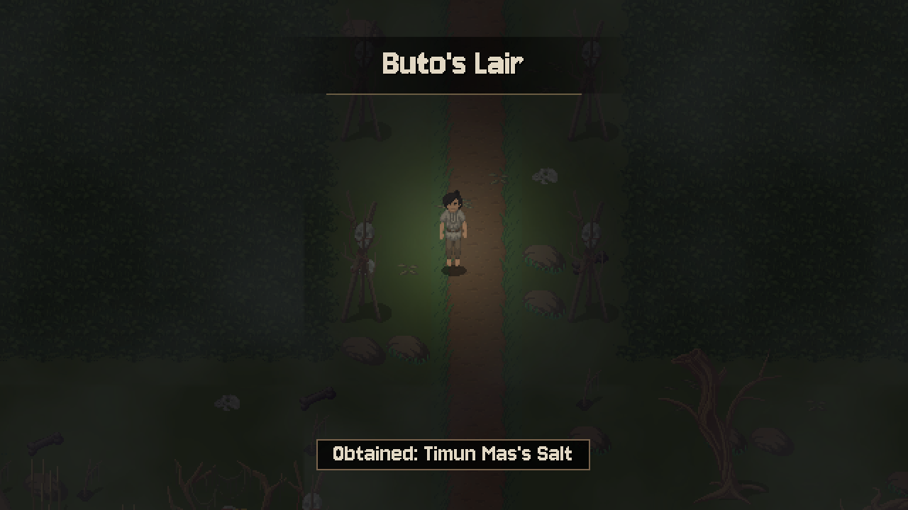

<h1 align="center">TUMBAL</h1>

<p align="center">
  <i>RPG turn-based bertema dongeng Timun Mas versi gelap, dengan gameplay ala Souls.<br>Dibuat dari nol pakai C++17 dan raylib untuk Tugas Besar Struktur Data.</i>
</p>

<p align="center">
  <a href="#-instalasi">Instalasi</a> •
  <a href="#-fitur-utama">Fitur</a> •
  <a href="#-pratinjau">Pratinjau</a> •
  <a href="#-struktur-data">Struktur Data</a> •
  <a href="#-anggota-tim">Anggota Tim</a>
</p>

<p align="center">
  
  
  
  
  
  
  
</p>

<p align="center">
  
</p>

<p align="center">
  <b>⚔️ Battle ATB</b> <i>(urutan giliran ditentukan kecepatan, ada rapal dan tunda giliran)</i>
  <br>
  <b>🔥 Loop ala Souls</b> <i>(checkpoint Tungku, sukma jatuh saat mati, musuh respawn)</i>
  <br>
  <b>🗺️ 8 area yang saling terhubung</b> <i>(ada jalan pintas, jalan satu arah, dan fast travel)</i>
  <br>
  <b>📜 Cerita lengkap sampai tamat</b> <i>(sekitar 45–60 menit)</i>
  <br>
  <b>🧱 Semua struktur data dibuat manual</b> <i>(tanpa container STL di core game)</i>
</p>

<details>
<summary><b>Daftar Isi</b></summary>

- [Deskripsi](#-deskripsi)
- [Instalasi](#-instalasi)
- [Kontrol](#-kontrol)
- [Pratinjau](#-pratinjau)
- [Fitur Utama](#-fitur-utama)
- [Struktur Data](#-struktur-data)
- [Arsitektur](#-arsitektur)
- [Struktur Folder](#-struktur-folder)
- [Command Line](#-command-line)
- [Tools](#-tools)
- [FAQ](#-faq)
- [Dokumentasi](#-dokumentasi)
- [Anggota Tim](#-anggota-tim)
- [Kredit & Lisensi](#-kredit--lisensi)

</details>

---

## 📖 Deskripsi

**TUMBAL** adalah game RPG turn-based yang mengangkat dongeng **Timun Mas dan Buto Ijo**, tapi dengan
versi yang lebih gelap.

Di dongeng aslinya, Timun Mas kabur dari Buto Ijo dengan melempar empat bekal: biji timun yang jadi ladang,
jarum yang jadi hutan bambu, garam yang jadi laut, dan terasi yang jadi rawa. Di game ini, ceritanya
berlanjut. Sihir dari bekal itu tidak pernah hilang, malah membusuk, dan Buto Ijo ternyata belum benar-benar
mati. Supaya tetap aman, warga Desa Karangtumbal menyerahkan satu anak setiap musim panen sebagai tumbal.

Kamu bermain sebagai salah satu tumbal itu, yang seharusnya sudah dimakan tapi malah terbangun di dalam
lumbung.

Game ini dibuat untuk **Tugas Besar mata kuliah Struktur Data**. Gameplay-nya terinspirasi dari
*Black Souls 1*, tapi yang kami adaptasi hanya sistem permainannya. Cerita, karakter, peta, dialog, dan
grafisnya kami buat sendiri atau memakai aset gratis yang lisensinya mengizinkan.

---

## 🚀 Instalasi

> [!TIP]
> Bahasa bawaan game adalah **English**. Untuk ganti ke **Bahasa Indonesia**, buka **Settings** di layar judul
> atau di menu dalam game (tombol X). Pilihan bahasa akan tersimpan otomatis.

### Persyaratan

Pastikan kamu sudah punya:

- **Windows**
- **[MSYS2](https://www.msys2.org/)** dengan toolchain **UCRT64**

Setelah MSYS2 terinstall, buka terminal **MSYS2 UCRT64** lalu install compiler, raylib, dan make:

```bash
pacman -S mingw-w64-ucrt-x86_64-gcc mingw-w64-ucrt-x86_64-raylib mingw-w64-ucrt-x86_64-make
```

Lalu tambahkan `C:\msys64\ucrt64\bin` ke `PATH` Windows.

### Clone & Jalankan

```bash
git clone https://github.com/DaffMe/Tumbal.git
cd Tumbal
mingw32-make run
```

Perintah lain yang berguna:

```bash
mingw32-make test          # jalankan semua unit test
bin/tumbal.exe --console   # main versi console (teks), tanpa GUI
```

---

## 🎮 Kontrol

| Tombol | Fungsi |
|--------|--------|
| Panah / WASD | Jalan (8 arah) |
| Shift | Lari |
| Z / Enter | Konfirmasi, periksa, bicara, istirahat di Tungku |
| X / Esc | Batal / buka menu (Barang, Status, Simpan, Cheat, Settings, Keluar) |
| Tahan Z saat battle | Percepat animasi |
| F1 | Inspector struktur data |
| F3 | Tampilkan collision |
| F9 | Menu cheat |

> [!NOTE]
> Sama seperti Black Souls, game **tidak menyimpan otomatis saat kamu mati**. Simpan manual lewat menu
> (ada 3 slot). Kalau mati, kamu bisa load lagi dari layar judul untuk mengulang.

---

## 📸 Pratinjau

> Screenshot diambil dari versi English.

<table>
<tr>
<td width="50%">

**Layar judul**


</td>
<td width="50%">

**Awal cerita**, terbangun di sel lumbung


</td>
</tr>
<tr>
<td width="50%">

**Desa Karangtumbal**, hub utama dengan Tungku, pandai besi, dan pedagang


</td>
<td width="50%">

**Laut Garam**, tempat Timun Mas menunggu di ujung dermaga


</td>
</tr>
<tr>
<td width="50%">

**Battle**, urutan giliran tampil di bagian atas


</td>
<td width="50%">

**Dialog** dengan potret karakter


</td>
</tr>
<tr>
<td width="50%">

**Pedagang keliling**, stok barangnya terbatas


</td>
<td width="50%">

**Empu Karta**, upgrade senjata sampai +3


</td>
</tr>
<tr>
<td width="50%">

**Rawa Terasi**, area terakhir sebelum boss


</td>
<td width="50%">

**Sarang Buto**, lokasi boss terakhir



</td>
</tr>
</table>

Peta lengkap tiap area bisa dilihat di [`docs/map_preview/`](docs/map_preview/).

---

## ✨ Fitur Utama

### ⚔️ Battle

- **Sistem ATB (Active Time Battle) mode wait.** Setiap karakter punya gauge yang terisi sesuai stat Gesit.
  Saat kamu memilih perintah, waktu berhenti, jadi tidak perlu terburu-buru.
- **Prediksi urutan giliran** tampil di bagian atas layar battle.
- **Rapal dan tunda.** Skill yang kuat butuh waktu untuk dirapal. Skill tunda bisa memundurkan giliran musuh
  sekaligus membatalkan rapalannya.
- **Elak dan Tangkis** bisa dipakai semua class.
- **Status effect**: racun, berdarah, terbakar, tidur, takut, cepat, lambat, dan lainnya.
- **Boss multi-bagian.** Buto Ijo terdiri dari kepala dan dua tangan. Kalau kepalanya kalah, kedua tangannya
  ikut tumbang. Sebelum serangan besarnya keluar, ada tanda target mana yang sedang diincar.

### 🗺️ Eksplorasi

- **8 area**: Sel Tumbal → Lorong Lumbung → Desa Karangtumbal → Ladang Timun Busuk → Hutan Bambu Jarum →
  Laut Garam → Rawa Terasi → Sarang Buto.
- **Musuh terlihat di peta** dan akan mengejar. Kalau kamu menyentuh musuh dari belakang, kamu dapat serangan
  pertama.
- **Tungku** berfungsi sebagai checkpoint. Di sini kamu bisa memulihkan HP, mengisi ulang Ramuan Jamu, naik
  level, dan fast travel ke Tungku lain. Setiap kali istirahat, musuh di semua area akan respawn.
- **Sukma** dipakai sebagai mata uang sekaligus EXP. Saat mati, sukma yang kamu bawa jatuh di lokasi tersebut
  dan bisa diambil lagi satu kali. Kalau mati lagi sebelum mengambilnya, sukma itu hilang.
- **Jalan pintas dan jalan satu arah**, misalnya jalan yang baru terbuka setelah boss dikalahkan dan rumpun
  bambu yang bisa ditebas untuk kembali ke desa.

### 📜 Cerita & Karakter

- **Dialog bercabang** dengan pilihan jawaban, dan beberapa NPC akan merespons progres kamu.
- **Timun Mas** bisa bergabung ke party setelah kamu menemukannya di Laut Garam.
- **Empu Karta** bisa meng-upgrade senjata (pakai sukma dan Bijih Besi), dan **pedagang keliling** menjual
  barang dengan stok terbatas.
- **Dua bahasa**: English (bawaan) dan Bahasa Indonesia.

### 🎨 Grafis & Audio

- Grafis pixel art bernuansa gelap, dengan warna, kabut, dan pencahayaan yang berbeda di tiap area.
- Musik desa bernuansa gamelan yang kami buat sendiri, musik per area, dan sound effect.
- Layar judul, pembuatan karakter (nama, class, barang awal), 3 slot save, dan layar tamat.

### 🛠️ Untuk Developer

- **377 unit test** untuk struktur data, battle, dunia, event, save/load, dan terjemahan.
- Mode **console** (`--console`), **screenshot otomatis** (`--shots`), dan **simulasi balancing** (`--balance`).
- **Menu cheat** (F9) untuk testing atau kalau ingin cepat tamat. Layar tamat akan mencatat kalau cheat dipakai.

---

## 🧱 Struktur Data

Sesuai ketentuan tugas, **semua struktur data yang dinilai dibuat manual** menggunakan node dan pointer, tanpa
memakai container STL seperti `std::vector` atau `std::map`. Implementasinya ada di folder
[`src/core/adt/`](src/core/adt/).

| Mekanik | Struktur Data | Jenis | Penggunaan di Game |
|---------|---------------|-------|--------------------|
| **M1** Battle & antrean giliran | Doubly Linked List terurut (`Timeline`) | Linear | Menyimpan antrean giliran. Node paling depan adalah karakter yang jalan berikutnya. Saat ada rapal atau tunda, node dipindahkan ke posisi yang baru |
| **M2** Dunia & Tungku | Graph (`Graph`) | Non-linear | Setiap peta jadi vertex dan setiap jalan jadi edge, yang bisa terkunci atau satu arah. BFS dipakai untuk mencari Tungku yang bisa dituju, dan traversal penuh untuk respawn musuh |
| **M3** Event & dialog | Stack + Queue | Linear | Stack menyimpan posisi eksekusi saat dialog bercabang atau memanggil event lain. Queue menampilkan notifikasi satu per satu |
| Pendukung battle | Queue | Linear | Event battle (damage, heal, tumbang) diantrekan lalu dianimasikan berurutan |

| File | ADT | Operasi |
|------|-----|---------|
| [`Timeline.hpp`](src/core/adt/Timeline.hpp) | Doubly Linked List terurut | `insertSorted`, `remove`, `popFront`, `search`, `updateAV`, `subtractAll`, traversal maju/mundur |
| [`Graph.hpp`](src/core/adt/Graph.hpp) | Graph berarah berbobot | `addVertex`, `addEdge`, `addArc`, `setOpen`, `isOpen`, `removeEdge`, `bfs`, `dijkstra`, `isConnected` |
| [`Stack.hpp`](src/core/adt/Stack.hpp) | Stack (linked list) | `push`, `pop`, `peek`, traversal |
| [`Queue.hpp`](src/core/adt/Queue.hpp) | Queue (linked list) | `enqueue`, `dequeue`, `peek`, traversal |

Tekan **F1** saat bermain untuk membuka Inspector. Di sana kamu bisa melihat isi antrean giliran, kondisi
graph peta (jalan mana yang terbuka atau terkunci), dan log operasi struktur data yang baru dijalankan.
Penjelasan lengkapnya ada di [`docs/STRUKTUR_DATA.md`](docs/STRUKTUR_DATA.md).

---

## 🏗️ Arsitektur

Kode game dibagi menjadi tiga bagian:

- **`src/core`** berisi semua logika game: battle, peta, event, save/load, dan struktur data. Bagian ini tidak
  bergantung pada raylib sama sekali.
- **`src/gui`** bertugas menampilkan grafis, memutar audio, dan meneruskan input ke core.
- **`src/console`** menjalankan core yang sama dalam bentuk teks, sebagai bukti logika game terpisah dari GUI.

```
┌──────────────────────────────────────────────────────────────────────────┐
│                     GUI  (src/gui, raylib)                               │
│  Title · Map · Battle · Dialog · Menu · Tungku · Shop · Inspector        │
│  hanya menampilkan state dan meneruskan input                            │
└──────────────┬───────────────────────────────────────────┬───────────────┘
               │                                           │
               ▼                                           ▼
┌──────────────────────────────────────────────────────────────────────────┐
│                     CORE  (src/core, tanpa raylib & container STL)       │
│                                                                          │
│  game/   Game, GameState (party, sukma, inventory, flag, save/load)      │
│  battle/ BattleSystem ── Timeline / Doubly Linked List (M1)              │
│  world/  World ── Graph peta (M2) · Field (pergerakan, musuh)            │
│  event/  Interpreter ── Stack + Queue (M3)                               │
│  data/   GameData (skill, item, musuh, class, senjata, toko)             │
│  util/   Json parser · Lang (EN/ID) · Rng · DsTrace                      │
└──────────────┬───────────────────────────────────────────┬───────────────┘
               │                                           │
               ▼                                           ▼
     CONSOLE  (src/console)                       ASSETS  (assets/)
     mode teks · simulasi --balance               peta Tiled, script event,
                                                  kamus bahasa, grafis, audio
```

---

## 📁 Struktur Folder

```
.
├── src/
│   ├── core/            logika game dan struktur data
│   ├── gui/             tampilan, audio, menu
│   ├── console/         mode console dan simulasi balancing
│   └── main.cpp         entry point
├── tests/               unit test
├── assets/
│   ├── maps/            peta (format Tiled)
│   ├── events/          script cerita dan dialog (JSON)
│   ├── lang/            kamus bahasa Inggris
│   └── ...              grafis, karakter, audio, font
├── tools/               script Python untuk generate aset, peta, musik, dan terjemahan
├── docs/                dokumentasi, screenshot, dan preview peta
├── CREDITS.md           daftar aset beserta lisensinya
└── Makefile
```

---

## ⌨️ Command Line

| Perintah | Keterangan |
|----------|------------|
| `bin/tumbal.exe` | Jalankan game |
| `bin/tumbal.exe --console` | Main di terminal (perintah: `w/a/s/d`, `x`, `graph`, `tungku`, `simpan`, `muat`, `cheat`, dll.) |
| `bin/tumbal.exe --shots` | Ambil screenshot otomatis semua area dan layar penting |
| `bin/tumbal.exe --balance` | Simulasi ribuan battle untuk mengecek tingkat kesulitan |
| `bin/tumbal.exe --smoke` | Buka window sebentar lalu tutup (cek hasil build) |

---

## 🧰 Tools

Semua script dijalankan dengan Python dari MSYS2 (`/c/msys64/ucrt64/bin/python.exe`) di root folder project.

| Script | Fungsi |
|--------|--------|
| `tools/build_assets.py` | Generate sprite karakter, tile, props, battler, dan potret |
| `tools/make_maps.py` | Generate semua peta dari layout ASCII ke format Tiled |
| `tools/render_maps.py` | Render preview tiap peta ke `docs/map_preview/` |
| `tools/make_gamelan.py` | Generate musik desa bernuansa gamelan |
| `tools/lang_en.py` | Generate kamus bahasa Inggris |
| `tools/lang_keys.py` | Cek teks yang belum diterjemahkan |

---

## ❓ FAQ

<details>
<summary><b>Apakah ini copy dari Black Souls?</b></summary>

Bukan. Yang kami adaptasi hanya sistem permainannya, seperti battle ATB, sukma sebagai mata uang dan EXP,
checkpoint, dan sukma yang jatuh saat mati. Cerita, karakter, peta, dialog, dan grafisnya kami buat sendiri
atau memakai aset gratis yang tercantum di `CREDITS.md`.

</details>

<details>
<summary><b>Kenapa tidak pakai <code>std::vector</code> atau <code>std::map</code>?</b></summary>

Karena ketentuan tugas mewajibkan struktur data yang dinilai dibuat manual. Aturan ini kami terapkan ke seluruh
core game (`src/core/`). Bagian GUI tetap boleh memakai standard library.

</details>

<details>
<summary><b>Game-nya terlalu susah, ada cara cepat?</b></summary>

Ada. Tekan **F9** atau buka menu lalu pilih **Cheat**. Di sana ada sukma dan level gratis, tambah stat,
senjata langsung +3, kebal, one-hit kill, sampai buka semua jalan. Layar tamat akan mencatat kalau cheat dipakai.

</details>

<details>
<summary><b>Bisa jalan di Linux atau macOS?</b></summary>

Secara kode bisa, tapi Makefile dan panduan instalasinya dibuat untuk Windows (MSYS2). Platform lain belum
kami coba.

</details>

---

## 📚 Dokumentasi

| Dokumen | Isi |
|---------|-----|
| [Panduan Demo](docs/DEMO.md) | Rute main dari awal sampai tamat dan titik presentasi tiap struktur data |
| [Struktur Data](docs/STRUKTUR_DATA.md) | Penjelasan ADT, kompleksitas, subprogram, dan bahan Pendampingan |
| [Rencana & Progres](docs/PLAN_V2.md) | Keputusan desain dan progres tiap fase |
| [Analisis Black Souls 1](docs/research/black-souls-1-analysis.md) | Analisis sistem game yang jadi acuan |
| [Kredit](CREDITS.md) | Daftar aset, pembuat, dan lisensinya |
| [CLAUDE.md](CLAUDE.md) | Aturan dan konvensi project |

---

## 👥 Anggota Tim

**Kelompok 12**

| Nama | NIM | Peran |
|------|-----|-------|
| Adi Tia Ragil Saputra | 109102500015 | Ketua Kelompok & Game Designer |
| Daffa Asqalany | 109102500013 | Game Programmer |
| Dina Aulia Rizky | 109102500011 | Penulis Laporan |

Dibuat untuk mata kuliah **Struktur Data**, semester ganjil 2026/2027.

### Penggunaan AI

Dalam pengerjaan kode dan dokumentasi, kami dibantu AI (Claude Code). Beberapa aset grafis yang tidak tersedia
versi gratisnya dibuat dengan bantuan Codex, dan semuanya tercatat di bagian "Aset buatan AI" pada
[`CREDITS.md`](CREDITS.md). Rincian penggunaan AI dijelaskan di laporan tugas besar.

---

## 📄 Kredit & Lisensi

Aset dari pihak lain (grafis, audio, dan font) dipakai sesuai lisensinya masing-masing (CC-BY 4.0, CC0, dan
SIL OFL). Daftar lengkapnya ada di [`CREDITS.md`](CREDITS.md). Terima kasih untuk Sevarihk / Aurora (tileset
dan karakter), Redshrike (sprite musuh), Nidhoggn (background battle), Kenney dan kreator di OpenGameArt
(audio), serta pembuat font Jersey 10.

Kode game ini belum memakai lisensi tertentu. Aset dari pihak lain tetap mengikuti lisensi aslinya.

---

<div align="center">

### "Tok... tok... tok..."

<sub>Lesung tidak boleh berhenti. Kalau sepi, ia tahu ada yang lari.</sub>

</div>
