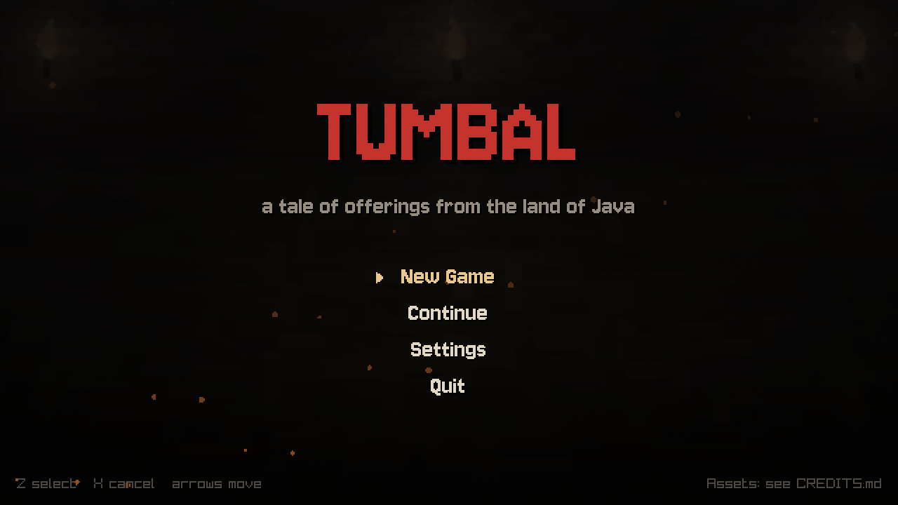
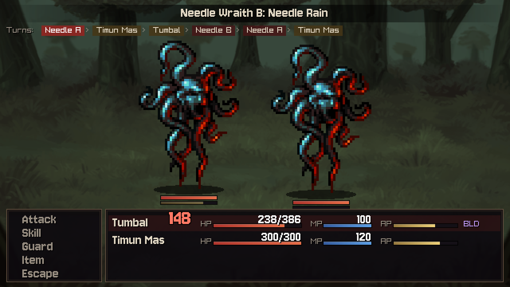
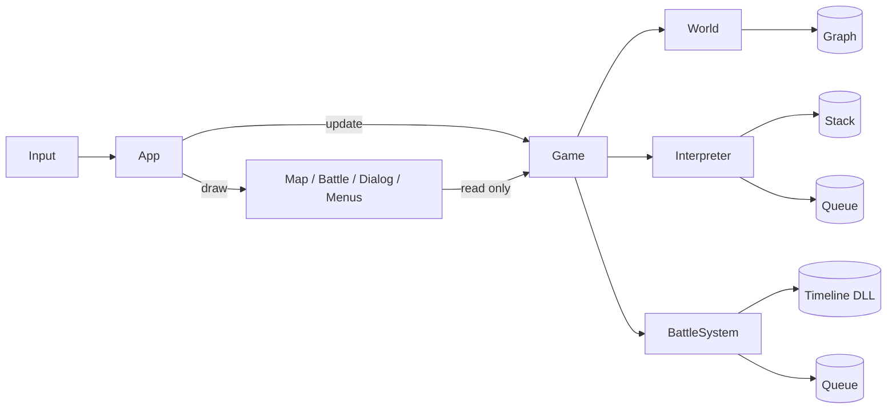

<h1 align="center">TUMBAL</h1>

<p align="center">
  <i>A dark Javanese folk-tale JRPG with Souls-like mechanics, built from scratch in C++17 and raylib.</i>
</p>

<p align="center">
  <a href="#-quick-start">Quick Start</a> •
  <a href="#-features">Features</a> •
  <a href="#-screenshots">Screenshots</a> •
  <a href="#-data-structures">Data Structures</a> •
  <a href="#-documentation">Documentation</a>
</p>

<p align="center">
  
  
  
  
  
  
  
</p>

<p align="center">
  
</p>

<p align="center">
  <b>⚔️ Wait-mode ATB battles</b> <i>(AP gauges, chanting, delays, a predicted turn-order strip)</i>
  <br>
  <b>🔥 A Souls loop</b> <i>(Hearths, lost souls you can recover once, enemies that rise again)</i>
  <br>
  <b>🗺️ An interconnected world</b> <i>(8 maps, locked shortcuts, one-way drops, warping between lit Hearths)</i>
  <br>
  <b>📜 A full story</b> <i>(Timun Mas and Buto Ijo, retold darkly, from the first cell to the ending)</i>
  <br>
  <b>🧱 Hand-made data structures</b> <i>(doubly linked list, graph, stack, queue: no STL containers in the game core)</i>
</p>

<details>
<summary><b>Table of Contents</b></summary>

- [Quick Start](#-quick-start)
- [Screenshots](#-screenshots)
- [About the Game](#-about-the-game)
- [Features](#-features)
- [Data Structures](#-data-structures)
- [Architecture](#-architecture)
- [Project Structure](#-project-structure)
- [Command-line Options](#-command-line-options)
- [Asset & Map Tools](#-asset--map-tools)
- [FAQ](#-faq)
- [Documentation](#-documentation)
- [Team](#-team)
- [Credits & License](#-credits--license)

</details>

---

## 🚀 Quick Start

> [!TIP]
> The game starts in **English**. Switch to **Bahasa Indonesia** any time under **Settings** (title screen or the in-game X menu); the choice is remembered.

### Requirements

- Windows with [MSYS2](https://www.msys2.org/) and the **UCRT64** toolchain
- `C:\msys64\ucrt64\bin` on your `PATH`

```bash
pacman -S mingw-w64-ucrt-x86_64-gcc mingw-w64-ucrt-x86_64-raylib mingw-w64-ucrt-x86_64-make
```

### Build & play

```bash
mingw32-make run           # build and start the game
mingw32-make test          # build and run all unit tests
bin/tumbal.exe --console   # the same game logic, as a text adventure in the terminal
```

### Controls

| Key | Action |
|-----|--------|
| Arrows / WASD | Move (8 directions) |
| Shift | Run |
| Z / Enter | Confirm, examine, talk, rest at a Hearth |
| X / Esc | Cancel, open the menu (Item, Status, Save, Cheats, Settings, Quit) |
| Hold Z in battle | Speed up animations |
| F1 | Data structure Inspector |
| F3 | Show collision |
| F9 | Cheat menu |

> [!NOTE]
> Like Black Souls, the game **never saves on death**. Save anywhere from the menu (3 slots) and reload from the title screen to undo a death.

---

## 📸 Screenshots

<table>
<tr>
<td width="50%">

**Title screen**



</td>
<td width="50%">

**The first cell** — the story opens in a granary where children are kept


</td>
</tr>
<tr>
<td width="50%">

**Karangtumbal Village** — the hub, with a Hearth, a blacksmith and a merchant


</td>
<td width="50%">

**The Salt Sea** — Timun Mas waits at the end of a rotting pier


</td>
</tr>
<tr>
<td width="50%">

**Battle** — wait-mode ATB with a predicted turn-order strip



</td>
<td width="50%">

**Dialog** — speaker portraits drawn from each character's map sprite


</td>
</tr>
<tr>
<td width="50%">

**Wandering merchant** — limited stock, paid in souls


</td>
<td width="50%">

**Empu Karta's forge** — temper your weapon from +0 to +3


</td>
</tr>
<tr>
<td width="50%">

**Terasi Mire** — fog, reeds and the last Hearth before the lair


</td>
<td width="50%">

**Buto's Lair** — a slope lined with skull totems leads to the final boss


</td>
</tr>
</table>

Full-map previews of every area are in [`docs/map_preview/`](docs/map_preview/).

---

## 🎯 About the Game

In the folk tale, Timun Mas escapes the giant Buto Ijo by throwing four magic provisions behind her: a cucumber
seed that becomes a field, a needle that becomes a bamboo forest, salt that becomes a sea, and shrimp paste
(*terasi*) that becomes a swamp. **TUMBAL** (Javanese/Indonesian for *sacrificial offering*) asks what happened
next: the magic never faded, it rotted, and the village of Karangtumbal has been feeding its children to the
giant ever since.

You are an **Offering** who was supposed to be eaten, and woke up instead.

The game was made for a university **Data Structures** course. Its mechanics are adapted from *Black Souls 1*
(an RPG Maker VX Ace game): only the **systems** are reproduced. The world, story, characters, maps, text and
art are original.

### Built for

- 🎓 **Data Structures coursework** — every graded structure is hand-written with nodes and pointers and is used by a running mechanic
- 🕹️ **A real play session** — about 45–60 minutes from the first cell to the ending
- 🖥️ **GUI and console** — the game logic has no dependency on the renderer, proven by a full text mode

---

## ✨ Features

### ⚔️ Battle (M1)

- **Wait-mode ATB** like Black Souls: AP gauges fill by Agility and freeze completely while you choose
- **Turn-order strip** predicted by simulating a copy of the turn timeline
- **Chanting & delays** — strong skills take time to chant; delay skills push enemies back and break their chants
- **Evade & Parry** for every class, status effects (poison, bleed, burn, sleep, fear, haste, slow, ...), elements
- **Telegraphed boss attacks** — Buto Ijo's big moves are chanted first: the skill name floats over the enemy and the targeted ally flashes
- **Multi-part boss** — Buto Ijo's head and two hands; fell the head and the hands collapse

### 🗺️ World & Souls loop (M2)

- **8 interconnected maps**: Offering Cell → Granary Corridor → Karangtumbal Village → Rotten Cucumber Fields → Needle Bamboo Forest → The Salt Sea → Terasi Mire → Buto's Lair
- **Visible enemies** that chase you; touching them from behind gives you the first strike
- **Hearths**: rest to heal and refill Jamu Draughts, level up with souls, warp to any lit Hearth you can reach
- **Lost souls**: die and your souls stay where you fell; recover them once, or lose them forever
- **Shortcuts & gates**: a boss-locked path, a bamboo shortcut back to the village, a one-way drop into the lair

### 📜 Story & events (M3)

- **Event interpreter** for dialog, choices, nested conditions, items, battles, map transfers and shops
- **Reactive NPCs** — Mbok Srini responds to what you have done; a companion, **Timun Mas**, joins your party
- **Empu Karta's forge** (+0 to +3 weapons with souls and Iron Ore) and a **wandering merchant**
- **Two languages** — English (default) and Bahasa Indonesia, switchable in Settings

### 🎨 Presentation

- Pixel-art maps with per-region palettes, scattered decoration, drifting fog and torch-like lighting
- Front-view battlers, original gamelan-style village music, per-map music with crossfades, sound effects
- Title screen, character creation (name, class, starting gift), 3 save slots, ending screen

### 🛠️ Tooling

- **377 unit tests** for the data structures, battle, world, events, saves and translations
- `--console` text mode, `--shots` automatic screenshots, `--balance` battle simulator
- Python generators for assets, maps, map previews, music and translations
- Built-in **cheat menu** (F9) for testing or a quick finish; the ending remembers if you used it

---

## 🧱 Data Structures

All graded data structures live in [`src/core/adt/`](src/core/adt/), written by hand with nodes and pointers.
The game core (`src/core/`) uses **no STL containers** (`std::vector`, `std::list`, `std::map`, ...) and never
includes raylib.

| Mechanic | Main structure | Type | What it does in the game |
|----------|----------------|------|--------------------------|
| **M1** Battle ATB + turn order | `Timeline<Battler>` — sorted **doubly linked list** | Linear | Head = next to act. Chants and delays move a node to its new place; the turn strip comes from a copied list |
| **M2** World & Hearths | `Graph<MapInfo>` — **adjacency multi linked list** | Non-linear | Maps are vertices, paths are edges that can be locked or one-way. BFS finds reachable Hearths; a full traversal revives enemies |
| **M3** Event interpreter | `Stack<Frame>` + `Queue<std::string>` | Linear | Branches and called scripts push frames and return in LIFO order; notifications are shown one at a time |
| Support | `Queue<BattleEvent>` | Linear | Battle logic queues events; the GUI and console play them back in order |

| File | ADT | Operations |
|------|-----|------------|
| [`Timeline.hpp`](src/core/adt/Timeline.hpp) | Sorted doubly linked list | `insertSorted`, `remove`, `popFront`, `search`, `updateAV` (relink), `subtractAll`, forward/backward traversal |
| [`Graph.hpp`](src/core/adt/Graph.hpp) | Weighted directed graph, lockable edges | `addVertex`, `addEdge`, `addArc`, `setOpen`, `isOpen`, `removeEdge`, `bfs`, `dijkstra`, `isConnected` |
| [`Stack.hpp`](src/core/adt/Stack.hpp) | Linked stack | `push`, `pop`, `peek`, traversal |
| [`Queue.hpp`](src/core/adt/Queue.hpp) | Linked queue | `enqueue`, `dequeue`, `peek`, traversal |

Every data structure operation used by a mechanic is logged (`dsOp`) and shown live in the **F1 Inspector**
and as `[DS]` lines in console mode. A full write-up with complexity, subprograms and presentation notes is in
[`docs/STRUKTUR_DATA.md`](docs/STRUKTUR_DATA.md) (Indonesian).

---

## 🏗️ Architecture

```
┌──────────────────────────────────────────────────────────────────────────┐
│                     GUI  (src/gui, raylib)                               │
│  Title · Map · Battle · Dialog · Menus · Hearth · Shop · Inspector       │
│  reads core state, forwards input — no game rules here                   │
└──────────────┬───────────────────────────────────────────┬───────────────┘
               │                                           │
               ▼                                           ▼
┌──────────────────────────────────────────────────────────────────────────┐
│                     GAME CORE  (src/core, no raylib, no STL containers)  │
│                                                                          │
│  game/   Game (glue), GameState (party, souls, items, flags, saves)      │
│  battle/ BattleSystem ── Timeline DLL (M1) · Queue<BattleEvent>          │
│  world/  World ── Graph of maps (M2) · Field (movement, enemies)         │
│  event/  Interpreter ── Stack<Frame> · Queue<notice> (M3) · Scripts      │
│  data/   GameData (skills, items, enemies, classes, weapons, shop)       │
│  util/   Json parser · Lang (EN/ID dictionary) · Rng · DsTrace           │
└──────────────┬───────────────────────────────────────────┬───────────────┘
               │                                           │
               ▼                                           ▼
     CONSOLE  (src/console)                       DATA FILES  (assets/)
     text mode · --balance simulator              Tiled maps · event JSON
                                                  lang/en.json · art · audio
```



---

## 📁 Project Structure

```
.
├── src/
│   ├── core/            game logic (no raylib): adt/, battle/, data/, event/, game/, util/, world/
│   ├── gui/             raylib front end: views, audio, UI helpers, settings
│   ├── console/         text mode and the --balance simulator
│   └── main.cpp         entry point and command-line options
├── tests/               unit tests (ADTs, battle, world, events, translations)
├── assets/
│   ├── maps/            Tiled maps (.tmj) + world.json, generated by tools/make_maps.py
│   ├── events/          story & NPC scripts (JSON)
│   ├── lang/            en.json, generated by tools/lang_en.py
│   ├── src/ raw/        source art & Codex originals used by tools/build_assets.py
│   └── tiles/ props/ chars/ battlers/ battlebacks/ faces/ audio/ fonts/
├── tools/               Python generators and checkers
├── docs/                design, demo guide, data structures, screenshots, map previews
├── CREDITS.md           every third-party and AI-made asset, with licenses
└── Makefile
```

---

## ⌨️ Command-line Options

| Option | Description |
|--------|-------------|
| *(none)* | Start the game |
| `--console` | Play in the terminal with the same core logic (commands: `w/a/s/d`, `x`, `graph`, `tungku`, `simpan`, `muat`, `cheat`, ...) |
| `--shots` | Take automatic screenshots of every map, dialog, battle, menus and the boss (`shot_*.png`) |
| `--balance` | Simulate thousands of battles per class × enemy group × level and print the difficulty curve |
| `--smoke` | Open the window briefly and exit (build check) |

---

## 🧰 Asset & Map Tools

All tools run with the MSYS2 Python (`/c/msys64/ucrt64/bin/python.exe`) from the repository root.

| Script | What it does |
|--------|--------------|
| `tools/build_assets.py` | Builds characters, tiles, props, battlers, portraits and Codex art from `assets/src` and `assets/raw` |
| `tools/make_maps.py` | Generates every map from ASCII layouts into Tiled `.tmj` files + `world.json` |
| `tools/render_maps.py` | Renders full previews of every map into `docs/map_preview/` |
| `tools/make_gamelan.py` | Synthesizes the original gamelan village theme (`assets/audio/music/desa.ogg`) |
| `tools/lang_en.py` | Writes the English dictionary `assets/lang/en.json` |
| `tools/lang_keys.py` | Collects every player-facing string and reports anything still untranslated |

---

## ❓ FAQ

<details>
<summary><b>Is this a copy of Black Souls?</b></summary>

No. Only the game **systems** are adapted (wait-mode ATB, souls as currency and EXP, bonfire-style checkpoints,
dropped souls, save-anywhere). The world, story, characters, maps, dialog and art are original or come from the
openly licensed packs listed in `CREDITS.md`.

</details>

<details>
<summary><b>Why no <code>std::vector</code> or <code>std::map</code>?</b></summary>

The course requires the graded data structures to be implemented by hand. The rule is applied to the whole
game core (`src/core/`), so every list, queue, stack and graph there is built from nodes and pointers or raw
arrays. The GUI may use the standard library.

</details>

<details>
<summary><b>The game is too hard. Can I skip the grind?</b></summary>

Yes. Press **F9** (or open the menu → **Cheats**) for free souls and levels, stat boosts, a +3 weapon,
invincibility, one-hit kills or opening every path. The ending screen notes that cheats were used.

</details>

<details>
<summary><b>Does it run on Linux or macOS?</b></summary>

The code is portable C++17 and raylib, but the Makefile and instructions target Windows with MSYS2 UCRT64. Other
platforms have not been tested.

</details>

---

## 📚 Documentation

| Document | Description |
|----------|-------------|
| [Demo guide](docs/DEMO.md) | Full route, where each data structure shows up, quick checks (ID) |
| [Data structures](docs/STRUKTUR_DATA.md) | ADTs, complexity, subprograms, presentation Q&A (ID) |
| [Plan & phases](docs/PLAN_V2.md) | Design decisions and the phase-by-phase status (ID) |
| [Black Souls 1 analysis](docs/research/black-souls-1-analysis.md) | Study of the reference game's systems (ID) |
| [Credits](CREDITS.md) | Every asset, its author and license |
| [CLAUDE.md](CLAUDE.md) | Project rules and conventions for contributors and AI agents (ID) |

---

## 👥 Team

| Name | Student ID | Role |
|------|------------|------|
| _(to be filled)_ | _(to be filled)_ | Game programmer |
| _(to be filled)_ | _(to be filled)_ | Planning |
| _(to be filled)_ | _(to be filled)_ | Report |

Made for the **Data Structures** course, odd semester 2026/2027.

### Use of AI

Code and documentation were developed with the help of AI (Claude Code). A few art assets with no free
equivalent were generated with Codex; they are listed under "AI-made assets" in [`CREDITS.md`](CREDITS.md).
Details of AI use are reported in the course report, as the assignment requires.

---

## 📄 Credits & License

Third-party assets (CC-BY 4.0 / CC0 / SIL OFL) are listed with their authors and sources in
[`CREDITS.md`](CREDITS.md). Notable sources: Sevarihk / Aurora (tiles and characters), Redshrike (battlers),
Nidhoggn (battle backgrounds), Kenney and OpenGameArt artists (audio), and the Jersey 10 font.

No license file has been added for the game's own code yet. Third-party assets keep their original licenses.

---

<div align="center">

### “Tok... tok... tok...”

<sub>The rice mortar never stops. If it falls silent, he knows someone has run.</sub>

</div>
