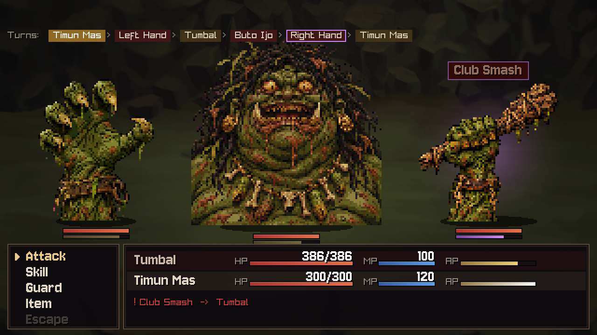
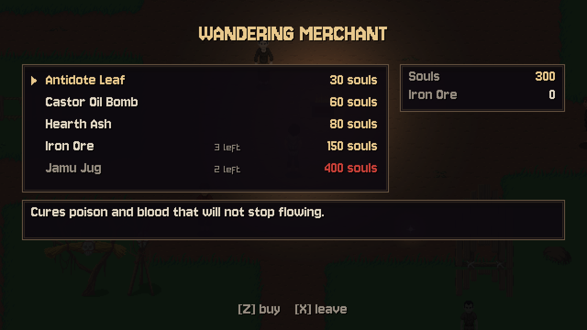

<h1 align="center">TUMBAL</h1>

<p align="center">
  <i>Game RPG bertema dongeng Timun Mas versi seram, dengan gaya main ala Souls. Dibuat sendiri dari nol pakai C++ dan raylib.</i>
</p>

<p align="center">
  <a href="#-cara-main">Cara Main</a> •
  <a href="#-isi-game">Isi Game</a> •
  <a href="#-cuplikan-layar">Cuplikan Layar</a> •
  <a href="#-struktur-data-yang-dipakai">Struktur Data</a> •
  <a href="#-kelompok-12">Kelompok</a>
</p>

<p align="center">
  
  
  
  
  
  
  
</p>

<p align="center">
  
</p>

<p align="center">
  <b>⚔️ Pertarungan bergiliran</b> <i>(siapa yang lebih gesit, dia jalan duluan)</i>
  <br>
  <b>🔥 Mati itu bagian dari permainan</b> <i>(sukma jatuh di tempat kamu mati, ambil lagi kalau berani)</i>
  <br>
  <b>🗺️ 8 wilayah yang saling nyambung</b> <i>(lumbung, desa, ladang, hutan bambu, laut, rawa, sarang Buto)</i>
  <br>
  <b>📜 Cerita lengkap dari awal sampai tamat</b> <i>(sekitar 45–60 menit main)</i>
  <br>
  <b>🧱 Semua struktur datanya bikin sendiri</b> <i>(sesuai aturan tugas: tanpa "jalan pintas" dari library C++)</i>
</p>

<details>
<summary><b>Daftar Isi</b></summary>

- [Cara Main](#-cara-main)
- [Cuplikan Layar](#-cuplikan-layar)
- [Ceritanya Tentang Apa?](#-ceritanya-tentang-apa)
- [Isi Game](#-isi-game)
- [Struktur Data yang Dipakai](#-struktur-data-yang-dipakai)
- [Cara Kerja Programnya](#-cara-kerja-programnya)
- [Isi Folder](#-isi-folder)
- [Perintah Tambahan](#-perintah-tambahan)
- [Alat Bantu](#-alat-bantu)
- [Pertanyaan yang Sering Muncul](#-pertanyaan-yang-sering-muncul)
- [Dokumen Lain](#-dokumen-lain)
- [Kelompok 12](#-kelompok-12)
- [Kredit & Lisensi](#-kredit--lisensi)

</details>

---

## 🚀 Cara Main

> [!TIP]
> Saat pertama dibuka, game pakai **bahasa Inggris**. Mau ganti ke **bahasa Indonesia**? Buka **Settings** di
> layar judul (atau tekan X waktu main, lalu pilih **Settings**). Pilihannya tersimpan, jadi nggak perlu ganti lagi.

### Yang perlu disiapkan

Game ini dibuat di Windows. Sebelum bisa dijalankan, pasang dulu [MSYS2](https://www.msys2.org/) (program untuk
meng-compile kode C++), lalu buka terminal **MSYS2 UCRT64** dan jalankan:

```bash
pacman -S mingw-w64-ucrt-x86_64-gcc mingw-w64-ucrt-x86_64-raylib mingw-w64-ucrt-x86_64-make
```

Setelah itu, tambahkan `C:\msys64\ucrt64\bin` ke `PATH` Windows supaya perintahnya bisa dipanggil dari mana saja.

### Menjalankan game

Buka terminal di folder proyek ini, lalu:

```bash
mingw32-make run           # compile lalu langsung main
mingw32-make test          # jalankan semua pengecekan otomatis (unit test)
bin/tumbal.exe --console   # main versi teks di terminal, tanpa gambar
```

### Tombol

| Tombol | Fungsinya |
|--------|-----------|
| Panah / WASD | Jalan (bisa serong) |
| Shift | Lari |
| Z / Enter | Pilih, periksa sesuatu, ngobrol, istirahat di Tungku |
| X / Esc | Batal, atau buka menu (Barang, Status, Simpan, Cheat, Settings, Keluar) |
| Tahan Z waktu bertarung | Mempercepat animasi |
| F1 | Lihat isi struktur data secara langsung |
| F3 | Lihat batas tabrakan di peta |
| F9 | Buka menu cheat |

> [!NOTE]
> Game **nggak pernah menyimpan otomatis waktu kamu mati**. Jadi rajin-rajin simpan lewat menu (ada 3 slot).
> Kalau mati dan nyesel, tinggal muat ulang simpanan dari layar judul.

---

## 📸 Cuplikan Layar

<table>
<tr>
<td width="50%">

**Layar judul**


</td>
<td width="50%">

**Awal cerita**: kamu bangun di sel lumbung tempat anak-anak dikurung


</td>
</tr>
<tr>
<td width="50%">

**Desa Karangtumbal**: pusat permainan, ada Tungku, pandai besi, dan pedagang


</td>
<td width="50%">

**Laut Garam**: Timun Mas menunggu di ujung dermaga


</td>
</tr>
<tr>
<td width="50%">

**Pertarungan**: urutan giliran kelihatan di bagian atas layar


</td>
<td width="50%">

**Dialog**: wajah tokoh yang sedang bicara muncul di samping teks


</td>
</tr>
<tr>
<td width="50%">

**Pedagang keliling**: beli barang pakai sukma, stoknya terbatas



</td>
<td width="50%">

**Empu Karta si pandai besi**: perkuat senjatamu sampai +3


</td>
</tr>
<tr>
<td width="50%">

**Rawa Terasi**: berkabut, dan jadi tempat istirahat terakhir sebelum ketemu Buto


</td>
<td width="50%">

**Sarang Buto**: jalan menurun yang dijaga tiang-tiang tengkorak


</td>
</tr>
</table>

Gambar di atas diambil dari versi bahasa Inggris. Gambar utuh tiap peta bisa dilihat di
[`docs/map_preview/`](docs/map_preview/).

---

## 🎯 Ceritanya Tentang Apa?

Semua orang tahu dongeng Timun Mas: dikejar raksasa Buto Ijo, Timun Mas melempar empat bekal dari ibunya.
Biji timun jadi ladang, jarum jadi hutan bambu, garam jadi laut, dan terasi jadi rawa. Buto Ijo tenggelam.

Di game ini, ceritanya **nggak berhenti di situ**. Sihir dari bekal-bekal itu nggak pernah hilang, malah
membusuk. Buto Ijo ternyata nggak benar-benar mati. Dan supaya desa tetap aman, warga desa Karangtumbal diam-diam
menyerahkan satu anak setiap musim panen sebagai **tumbal**.

Kamu adalah salah satu tumbal itu. Harusnya kamu sudah dimakan. Tapi kamu malah terbangun di dalam lumbung.

Game ini dibuat untuk **Tugas Besar mata kuliah Struktur Data**. Cara mainnya terinspirasi dari game
*Black Souls 1*, tapi yang kami ambil cuma **aturan mainnya** saja. Dunia, cerita, tokoh, peta, dialog, dan
gambarnya semua buatan sendiri atau pakai aset gratis yang boleh dipakai ulang.

---

## ✨ Isi Game

### ⚔️ Pertarungan

- **Bergiliran berdasarkan kecepatan.** Tiap tokoh punya bar yang terisi pelan-pelan; makin gesit, makin cepat
  penuh dan makin sering dapat giliran. Waktu kamu sedang memilih perintah, semuanya berhenti dulu, jadi nggak
  perlu buru-buru.
- **Urutan giliran kelihatan.** Di atas layar ada daftar siapa yang jalan berikutnya, jadi kamu bisa mengatur
  strategi.
- **Jurus yang perlu "dirapal".** Jurus kuat butuh waktu sebelum keluar. Kalau musuh sedang merapal, kamu bisa
  mengganggunya supaya jurusnya batal.
- **Elak dan Tangkis.** Semua kelas bisa menghindar atau menangkis serangan sampai giliran berikutnya.
- **Efek status**: racun, berdarah, terbakar, tidur, takut, makin cepat, makin lambat, dan lain-lain.
- **Boss tiga bagian.** Buto Ijo punya kepala dan dua tangan. Kalahkan kepalanya, kedua tangannya ikut tumbang.
  Sebelum serangan besarnya keluar, game kasih tanda dulu siapa yang diincar.

### 🗺️ Dunia dan sistem "mati lalu bangkit"

- **8 wilayah**: Sel Tumbal → Lorong Lumbung → Desa Karangtumbal → Ladang Timun Busuk → Hutan Bambu Jarum →
  Laut Garam → Rawa Terasi → Sarang Buto.
- **Musuh kelihatan di peta** dan akan mengejarmu. Kalau kamu menyentuh musuh dari belakang, kamu dapat
  serangan pertama.
- **Tungku** adalah tempat istirahat. Di sini kamu bisa memulihkan darah, mengisi ulang ramuan, naik level, dan
  pindah cepat ke Tungku lain yang sudah dinyalakan. Tapi hati-hati: setiap kamu istirahat, musuh-musuh ikut
  hidup lagi.
- **Sukma** adalah uang sekaligus poin pengalaman. Kalau kamu mati, semua sukma yang dibawa jatuh di tempat itu.
  Kamu punya satu kesempatan untuk mengambilnya lagi. Kalau mati lagi sebelum sempat, sukma itu hilang selamanya.
- **Jalan pintas.** Ada jalan yang baru terbuka setelah boss dikalahkan, rumpun bambu yang bisa ditebas jadi
  jalan pintas ke desa, dan jalan turun ke sarang Buto yang nggak bisa dinaiki lagi.

### 📜 Cerita dan tokoh

- **Tokoh yang ingat apa yang kamu lakukan.** Misalnya, Mbok Srini bakal ngomong beda setelah kamu mengalahkan
  Memedi Sawah atau bertemu Timun Mas.
- **Timun Mas bisa ikut bertarung** bersamamu setelah kamu menemukannya di Laut Garam.
- **Empu Karta** si pandai besi bisa memperkuat senjatamu (pakai sukma dan Bijih Besi), dan **pedagang
  keliling** menjual barang-barang berguna.
- **Dua bahasa**: Inggris (bawaan) dan Indonesia.

### 🎨 Tampilan dan suara

- Gambar bergaya pixel art dengan suasana gelap: tiap wilayah punya warna, kabut, dan pencahayaan sendiri.
- Musik desa bernuansa gamelan yang kami buat sendiri, musik yang berganti mulus tiap pindah peta, dan efek suara.
- Layar judul, pembuatan tokoh (nama, kelas, barang bawaan), 3 slot simpanan, dan layar tamat.

### 🛠️ Buat yang suka ngoprek

- **377 pengecekan otomatis (unit test)** untuk memastikan semua bagian berjalan benar.
- Bisa dimainkan versi teks (`--console`), ambil screenshot otomatis (`--shots`), dan simulasi ribuan
  pertarungan untuk mengukur tingkat kesulitan (`--balance`).
- **Menu cheat** (F9) kalau mau cepat tamat atau sekadar coba-coba. Tapi layar tamat bakal mencatat kalau kamu
  pakai cheat. 😉

---

## 🧱 Struktur Data yang Dipakai

Ini bagian utama untuk tugas besarnya. Sesuai aturan dosen, **semua struktur data yang dinilai dibuat sendiri**
dari node dan pointer, bukan memakai fitur siap pakai dari library C++ seperti `std::vector` atau `std::map`.
Semuanya ada di folder [`src/core/adt/`](src/core/adt/).

| Bagian game | Struktur data | Jenis | Kegunaannya |
|-------------|---------------|-------|-------------|
| **M1** Pertarungan & urutan giliran | **Doubly linked list** terurut (`Timeline`) | Linear | Menyimpan antrean giliran. Yang paling depan = yang jalan berikutnya. Kalau ada jurus yang menunda giliran, posisi tokoh itu langsung dipindah di dalam list |
| **M2** Dunia & Tungku | **Graph** (`Graph`) | Non-linear | Tiap peta = titik, tiap jalan antarpeta = garis penghubung. Garisnya bisa terkunci atau cuma satu arah. Dipakai untuk mencari Tungku yang bisa dituju dan menghidupkan lagi musuh di semua peta |
| **M3** Dialog & cerita | **Stack** + **Queue** | Linear | Stack mengingat "posisi baca" dialog saat cerita bercabang (misalnya waktu kamu memilih jawaban). Queue menampilkan notifikasi satu per satu, misalnya "Dapat: Bijih Besi" |
| Pendukung pertarungan | **Queue** | Linear | Kejadian di pertarungan (kena serangan, pulih, tumbang) diantrekan lalu dianimasikan satu per satu |

Mau lihat struktur datanya bekerja? Tekan **F1** saat main. Akan muncul panel yang menunjukkan isi antrean
giliran, graph peta (jalan mana yang terbuka atau terkunci), dan setiap operasi yang baru saja dijalankan.

Penjelasan lebih lengkap (termasuk kompleksitas dan bahan presentasi) ada di
[`docs/STRUKTUR_DATA.md`](docs/STRUKTUR_DATA.md).

---

## 🏗️ Cara Kerja Programnya

Programnya dibagi jadi beberapa bagian yang tugasnya jelas:

- **Otak game** (`src/core`) berisi semua aturan main: pertarungan, peta, cerita, simpanan, dan struktur data.
  Bagian ini sama sekali nggak tahu soal gambar atau suara.
- **Tampilan** (`src/gui`) cuma bertugas menggambar ke layar, memutar suara, dan meneruskan tombol yang ditekan
  ke otak game.
- **Versi teks** (`src/console`) memakai otak game yang sama tapi ditampilkan sebagai tulisan di terminal. Ini
  bukti kalau logikanya benar-benar terpisah dari tampilan.
- **Data** (`assets/`) berisi peta, naskah cerita, kamus bahasa, gambar, dan musik.

```
┌──────────────────────────────────────────────────────────────────────────┐
│                     TAMPILAN  (src/gui, raylib)                          │
│  layar judul · peta · pertarungan · dialog · menu · Tungku · toko        │
│  cuma menggambar dan meneruskan tombol, tidak mengatur aturan main       │
└──────────────┬───────────────────────────────────────────┬───────────────┘
               │                                           │
               ▼                                           ▼
┌──────────────────────────────────────────────────────────────────────────┐
│                     OTAK GAME  (src/core)                                │
│                                                                          │
│  game/   pengatur utama, data pemain, simpan & muat                      │
│  battle/ pertarungan ── antrean giliran (doubly linked list)             │
│  world/  peta & Tungku ── graph peta                                     │
│  event/  dialog & cerita ── stack + queue                                │
│  data/   daftar jurus, barang, musuh, kelas, senjata                     │
│  util/   pembaca JSON, kamus bahasa, angka acak, catatan operasi         │
└──────────────┬───────────────────────────────────────────┬───────────────┘
               │                                           │
               ▼                                           ▼
     VERSI TEKS  (src/console)                    DATA  (assets/)
     main lewat terminal                          peta, naskah cerita,
                                                  kamus bahasa, gambar, musik
```

---

## 📁 Isi Folder

```
.
├── src/
│   ├── core/            otak game (aturan main + struktur data)
│   ├── gui/             tampilan, suara, menu
│   ├── console/         versi teks + simulasi tingkat kesulitan
│   └── main.cpp         titik awal program
├── tests/               pengecekan otomatis (unit test)
├── assets/
│   ├── maps/            peta (format Tiled)
│   ├── events/          naskah cerita dan dialog
│   ├── lang/            kamus bahasa Inggris
│   └── ...              gambar, karakter, musik, font
├── tools/               skrip Python untuk membuat aset, peta, musik, dan terjemahan
├── docs/                dokumen tim, screenshot, gambar peta
├── CREDITS.md           daftar semua aset yang dipakai beserta lisensinya
└── Makefile             resep untuk meng-compile game
```

---

## ⌨️ Perintah Tambahan

| Perintah | Gunanya |
|----------|---------|
| `bin/tumbal.exe` | Main seperti biasa |
| `bin/tumbal.exe --console` | Main versi teks di terminal (perintahnya: `w/a/s/d` untuk jalan, `x` untuk periksa, `graph`, `tungku`, `simpan`, `muat`, `cheat`, dan lain-lain) |
| `bin/tumbal.exe --shots` | Ambil screenshot otomatis semua peta dan layar penting |
| `bin/tumbal.exe --balance` | Simulasi ribuan pertarungan untuk melihat seberapa susah tiap musuh di tiap level |
| `bin/tumbal.exe --smoke` | Buka jendela sebentar lalu tutup (cek apakah build berhasil) |

---

## 🧰 Alat Bantu

Semua alat ini dijalankan pakai Python bawaan MSYS2 (`/c/msys64/ucrt64/bin/python.exe`) dari folder proyek.

| Skrip | Gunanya |
|-------|---------|
| `tools/build_assets.py` | Menyusun gambar karakter, tile, properti peta, musuh, dan wajah tokoh |
| `tools/make_maps.py` | Membuat semua peta dari rancangan berbentuk teks |
| `tools/render_maps.py` | Menggambar ulang tiap peta secara utuh ke `docs/map_preview/` |
| `tools/make_gamelan.py` | Membuat musik desa bernuansa gamelan |
| `tools/lang_en.py` | Membuat kamus bahasa Inggris |
| `tools/lang_keys.py` | Mengecek apakah masih ada teks yang belum diterjemahkan |

---

## ❓ Pertanyaan yang Sering Muncul

<details>
<summary><b>Ini jiplakan Black Souls, ya?</b></summary>

Bukan. Yang kami ambil cuma aturan mainnya, seperti pertarungan berdasarkan kecepatan, sukma sebagai uang
sekaligus poin pengalaman, tempat istirahat, dan sukma yang jatuh saat mati. Cerita, tokoh, peta, dialog, dan
gambarnya semua buatan sendiri atau aset gratis yang daftarnya ada di `CREDITS.md`.

</details>

<details>
<summary><b>Kenapa nggak pakai <code>std::vector</code> atau <code>std::map</code> saja biar gampang?</b></summary>

Karena aturan tugasnya memang begitu: struktur data yang dinilai harus dibuat sendiri. Supaya aman, aturan ini
kami terapkan ke seluruh otak game (`src/core/`). Bagian tampilan masih boleh pakai fitur bawaan C++.

</details>

<details>
<summary><b>Game-nya susah banget. Ada cara cepat?</b></summary>

Ada. Tekan **F9** (atau buka menu lalu pilih **Cheat**). Di sana bisa dapat sukma dan level gratis, tambah
stat, senjata langsung +3, kebal, sekali pukul langsung menang, sampai membuka semua jalan. Tapi layar tamat
bakal mencatat kalau kamu pakai cheat.

</details>

<details>
<summary><b>Bisa dimainkan di Linux atau Mac?</b></summary>

Kodenya sebenarnya bisa, tapi cara compile dan petunjuk di sini dibuat khusus untuk Windows. Di sistem lain
belum pernah dicoba.

</details>

---

## 📚 Dokumen Lain

| Dokumen | Isinya |
|---------|--------|
| [Panduan demo](docs/DEMO.md) | Rute main dari awal sampai tamat, dan di mana tiap struktur data bisa ditunjukkan saat presentasi |
| [Struktur data](docs/STRUKTUR_DATA.md) | Penjelasan teknis tiap struktur data, kompleksitasnya, dan contoh tanya-jawab saat Pendampingan |
| [Rencana & progres](docs/PLAN_V2.md) | Keputusan desain dan progres tiap tahap pengerjaan |
| [Analisis Black Souls 1](docs/research/black-souls-1-analysis.md) | Catatan bedah sistem game yang jadi acuan |
| [Kredit](CREDITS.md) | Daftar aset, pembuatnya, dan lisensinya |
| [CLAUDE.md](CLAUDE.md) | Aturan dan kebiasaan penulisan kode di proyek ini |

---

## 👥 Kelompok 12

| Nama | NIM | Peran |
|------|-----|-------|
| Adi Tia Ragil Saputra | 109102500015 | Ketua Kelompok & Perancang Game (Game Designer) |
| Daffa Asqalany | 109102500013 | Programmer Utama (Game Developer) |
| Dina Aulia Rizky | 109102500011 | Penulis Laporan & Dokumentasi |

Dibuat untuk mata kuliah **Struktur Data**, semester ganjil 2026/2027.

### Penggunaan AI

Pembuatan kode dan dokumentasi dibantu AI (Claude Code). Beberapa gambar yang tidak ada versi gratisnya dibuat
dengan bantuan Codex, dan semuanya dicatat di bagian "Aset buatan AI" di [`CREDITS.md`](CREDITS.md). Rincian
penggunaan AI dijelaskan di laporan tugas besar sesuai ketentuan.

---

## 📄 Kredit & Lisensi

Gambar, suara, dan font dari pihak lain dipakai sesuai lisensinya (CC-BY 4.0, CC0, dan SIL OFL). Daftar
lengkapnya, termasuk nama pembuat dan sumbernya, ada di [`CREDITS.md`](CREDITS.md). Terima kasih khususnya
untuk Sevarihk / Aurora (tile dan karakter), Redshrike (gambar musuh), Nidhoggn (latar pertarungan), Kenney dan
para kreator di OpenGameArt (suara), serta pembuat font Jersey 10.

Kode game ini belum diberi lisensi. Aset dari pihak lain tetap mengikuti lisensi aslinya.

---

<div align="center">

### "Tok... tok... tok..."

<sub>Lesung tidak boleh berhenti. Kalau sepi, ia tahu ada yang lari.</sub>

</div>
